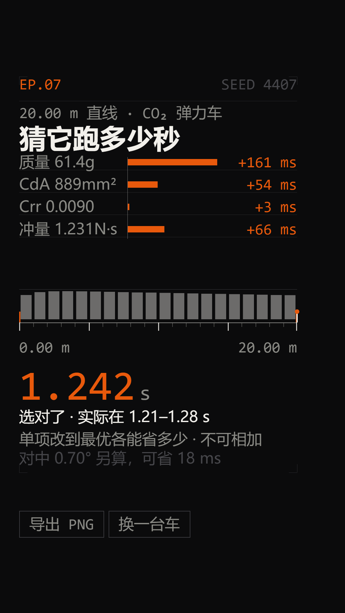

# 猜它跑多少秒

> 在线版：https://zhuka4141-cmyk.github.io/stem-racing/projects/guess-the-time/
一条 20 m 直线，一台随机生成的 CO₂ 弹力车，你选一个时间区间，跑完对答案，然后告诉你是哪几个参数把它拖慢了。

双击 `index.html` 就能玩，不用装东西，不用联网。

这一版是 EP.07。系列里每条发一台车。



## 怎么玩

页面打开是一台车的参数表和三个时间区间。选一个，车沿 20 m 跑一遍，速度曲线同时长出来，最后给实际时间和四个参数各自值多少毫秒。

`换一台车` 换 seed，`导出 PNG` 出 1080×1920 的图，直接能发。

## 车是怎么算出来的

运动方程就一条：

```
(m + Σ I_w / r_w²) · dv/dt = F(t) − ½ρ·CdA·v² − Crr·m·g − F_scrub
```

推力是一条衰减指数，这样积分出来正好等于设定的冲量：

```
F(t) = (J / τ) · e^(−t/τ)     ∫₀^∞ F dt = J
```

轮子的转动惯量没有单独建一个自由度，直接折进等效质量——`I_w = ½m_w r_w²`，除以 `r_w²` 就是 `½m_w`，四个轮子合起来加 `2m_w`。示例车 61.39 g，等效质量 66.22 g，轮子多出来 7.9%，这个量不能省。

积分用 RK4，步长 0.5 ms。

参数范围和状态：

| 量 | 取值 | 状态 |
|---|---|---|
| ρ 空气密度 | 1.204 kg/m³ | [fixed] |
| g | 9.81 m/s² | [fixed] |
| 赛道长 | 20.00 m | [VERIFY] 按我们赛场量的 |
| C_ALIGN | 4.0 | [typical] 集总系数，见已知问题 |
| 车质量 | 52.0–64.0 g | [typical] |
| 单轮质量 | 2.4–3.6 g | [typical] |
| 轮半径 | 12.0–18.0 mm | [typical] |
| CdA | 380–1300 mm² | [typical] |
| Crr | 0.0020–0.0100 | [typical] |
| 冲量 J | 1.18–1.30 N·s | [VERIFY] |
| 推力时间常数 τ | 45–72 ms | [typical] |
| toe | 0.05–0.80° | [typical] |

`[fixed]` 是查表定的常数，`[typical]` 是我们队里几台车实测出来大致落在这个范围，`[VERIFY]` 是我们没把握、需要再量的。

冲量范围故意做得很窄。真实赛场上一个气瓶批次之间的差异本来就没多大，车的快慢主要来自质量、迎风面积、滚阻和对中。所以冲量这一项永远只值几十毫秒，看上去比质量弱很多，这是对的，不是 bug。

## 为什么答案一定落在 1.00–1.25 秒

`1.00–1.25 s` 是我们要的观感：快到有紧张感，又不至于快到看不清。

随机抽参数不一定落在这个区间，所以 `makeCar` 会重抽，最多 400 次。实测 2000 台车：

```
重抽      平均 1.23 次，最多 5 次
接受后    min 1.001   p50 1.168   max 1.250
```

4000 台全部落在带内，没有一台漏网。

两端极值：所有参数都取最优是 0.980 s，都取最差是 1.428 s。最优那台低于 1.00 s，所以界面上**不显示**「理论最快」这种参考值，否则和屏幕上的说法自相矛盾。只显示这台车自己的时间和四个消融值。

## 三个区间为什么不会重叠

不用随机数碰运气，直接算：

```js
correctLo = round((t − 0.035) * 100) / 100
correctHi = correctLo + 0.07
```

正确区间是 `[correctLo, correctHi]`，两个错误区间是 `[correctLo − 0.07, correctLo]` 和 `[correctHi, correctHi + 0.07]`，三个窗口首尾相接、不重叠。

因为 `correctLo` 是百分位取整，`t − correctLo` 最多偏离 0.035 s，所以 `t` 落在正确区间的中点附近，离两个边界至少有 `0.07 − 0.035 = 0.035 s` 的余量。

`selfTest()` 会逐台验证「恰好一个区间命中」，不是靠运气。

## 四个贡献值

做法是把某一个参数单独改到这个参数的最优值，其它三个不动，重算时间，差值就是这个参数的贡献。

四个数**不能相加**。因为改一个参数之后，剩下的参数各自的影响已经变了。屏幕上写了这句，但我知道还是容易被误读。

示例车（seed 4407）：

| 参数 | 当前值 | 改成最优能省 |
|---|---|---|
| 质量 | 61.39 g | 161 ms |
| CdA | 888.8 mm² | 54 ms |
| Crr | 0.0090 | 3 ms |
| 冲量 | 1.2307 N·s | 66 ms |

toe 不在表里，单独一行：0.70° 去掉能省 18 ms。因为 toe 是通过 `F_scrub` 这个集总项进来的，和上面四个不是同一套算法，混在一起列会让人以为是可加的。

## WebGPU 到底跑没跑起来

跑起来了。这一条我一开始判断错了，记一下。

**实测环境**：Chromium 148.0.7778.96，`file://` 直接打开，**没有加任何启动参数**。

```
navigator.gpu               → 存在
requestAdapter()            → 成功
requestDevice()             → 成功
getPreferredCanvasFormat()  → bgra8unorm
limits.maxTextureDimension2D→ 8192
```

我原本以为 headless 必须开 `--enable-unsafe-webgpu` 和 `--enable-features=Vulkan` 才有 GPU 上下文。实测七个参数组合全都没有 `navigator.gpu`，我以为是浏览器不支持。后来发现是测试方法的问题：我用 `page.setContent()` 在 `about:blank` 上测，那个环境里根本没有 GPU 上下文。改成导航到一个真实的 `file://` 页面，什么都没加，`navigator.gpu` 直接就有了。

所以之前那个「headless 需要开 GPU 开关」的结论是错的，是我测错地方了。

`page.screenshot()` 能抓到 WebGPU 的 swapchain，`qa/` 里的截图是有效的。

## 导出 PNG 踩的两个坑

**一、`drawImage` 读不出 WebGPU 画布。** 把 WebGPU canvas 画进一个 2D canvas，得到的是全透明 `0,0,0,0`。`toBlob` 同理。所以导出不能走这条路。

改成 `copyTextureToBuffer`：先把这一帧画进一张自己持有的 `rgba8unorm` 纹理，再拷到 buffer，`mapAsync` 读回来，拼成 `ImageData`。

**二、`bytesPerRow` 必须 256 字节对齐。** 1080 × 4 = 4320，不是 256 的倍数。真实对齐值是 4352，多出来 32 字节是要丢掉的 padding。不处理的话整张图会斜着错位。

读回来之后：`putImageData` 到一张 2D canvas，再把文字层 `drawImage` 上去，最后 `toBlob('image/png')`。实测 188 KB。

文字没有走 DOM，也没有用 GPU 画，而是单独一层 Canvas2D。这样屏幕显示和导出走的是完全同一套绘制调用，不存在「屏幕上和导出的不一样」这种事。

## 降级到 Canvas2D

拿不到 WebGPU 就自动换 Canvas2D，同一套绘制指令、同一套文字。

一个坑：拿过 `webgpu` 上下文的 canvas 不能再 `getContext('2d')`，所以降级时要整个换掉 canvas 元素，不能在原元素上重试。

两条路径都跑 gate，都是 26 项全过。我还做了一张逐像素对比：

```
两条路径差异 >2 的像素    0.057%
            >40 的像素    0.039%
```

差异全在 1 px 的细线上——GPU 用 SDF 覆盖率画，Canvas2D 用 `fillRect` 画，边缘那几个灰度级不同。结构上没有区别，没有缺块、没有错位。

想直接看降级效果：`index.html?backend=2d`。

## 自检

```bash
npm run gate
```

跑的是 `tests/gate.mjs`，26 项，包括：

- 控制台没有 `console.error`，没有 pageerror，没有 4xx
- 运行期没有任何网络请求（gate 里直接把非 `file://` 的请求 abort 掉，不是靠看日志）
- `selfTest()` 扫 400 个 seed，全部在带内，且每个都恰好一个区间正确
- 反向验证：故意喂一组极端参数（冲量 0.55 N·s、CdA 2400 mm²），必须被判出界，否则说明检查器根本没在工作
- 所有文字的实测包围盒都在安全内区 x 60–930 / y 240–1480，字号全部 ≥ 48 px
- 导出的是真 PNG，1080×1920，> 50 KB，且答案页确实在图里（数区域内的强调色像素）
- 1080×1920 和 1440×900 两种视口截图都存进 `qa/`

其他脚本：

```bash
node tests/numbers.mjs   # README 里所有数字，从模型直接算
node tests/parity.mjs    # 两条渲染路径逐像素比
node tests/bands.mjs qa/export.png   # 各版块的墨迹包围盒
node tests/ascii.mjs qa/export.png   # 粗颗粒 ASCII 预览
```

## 已知问题

**字体只保证在 Windows 上正常。** 用的是本机的 Bahnschrift、Consolas 和微软雅黑，没有把字体子集内嵌进页面。换一台没有这三个字体的机器会掉到后备字体，排版会变。要发到手机上得先做子集内嵌，这一版没做。

Bahnschrift 和 Consolas 都不含汉字，canvas 遇到缺字是**静默丢弃**的，不出错也不出方块，就是那一段直接没了。所以每条字体栈后面都强制接了 `"Microsoft YaHei", "Noto Sans SC", sans-serif`。

**WebGPU 只在 Chromium 148 上实测过。** Firefox 和 Safari 没测。

**两条渲染路径不是 100% 像素相同**，差 0.039%，都在 1 px 细线上，肉眼看不出来，但它确实不是同一个东西。

**`F_scrub` 是集总系数，不是接触力学模型。** `C_ALIGN = 4.0` 是我们对着几组实测时间反推出来的，物理意义只是「把对中做差的那部分阻力一起打包」。toe 的影响只能当量级看，不能当预测值。这个必须说清楚，不然就是编数。

**四个贡献值不能相加。** 已经在屏幕上了，但还是容易被误读。

**只建模了单条 20 m 直线。** 没有导轨偏差累积，没有车头抬起，没有撞墙。

**车的外形是从参数反推的示意图。** `widthMM` 由 CdA 推出来，轮位由轮径推出来，不是真车图纸，只保证和数字一致。

**冲量范围窄，导致这一项观感偏弱。** 见上面的解释，是有意的。

**`换一台车` 用的是随机数，不是递增 seed。** 想复现某一台车得用 `?seed=` 指定。

**没做触摸和手势的专项测试。** 只在桌面 Chromium 上验证过。

## 文件

```
index.html          页面骨架，classic script 按顺序加载
src/core.js         调色板、字体栈、RNG、绘制指令结构
src/physics.js      RK4 运动方程、参数范围、贡献消融、能量闭环
src/car.js          确定性的造车和出题
src/backend-gpu.js  WGSL 着色器 + 实例化管线 + 导出读回
src/backend-2d.js   Canvas2D 同指令实现
src/scene.js        GT.LAYOUT 几何表 + 场景构建
src/ui.js           所有文字，返回实测文字包围盒
src/app.js          状态机、合成、导出、selfTest
tests/              gate、png 解码、数字、一致性、版块探测
qa/                 截图和导出样本
```

`file://` 下不允许 ES module，所以全部用 classic `<script>`，挂一个 `window.GT` 命名空间。WGSL 也只能写成 JS 字符串，不能 `fetch` 一个 `.wgsl` 文件。

## 关于这一集的数字

seed 4407 那台：

```
质量 61.39 g    单轮 2.42 g    轮半径 13.60 mm
CdA 888.8 mm²   Crr 0.0090     冲量 1.2307 N·s
τ 55.6 ms       toe 0.70°
等效质量 66.22 g（轮子 +7.9%）
时间 1.2421 s   终点 15.27 m/s   峰值 17.80 m/s
峰值推力 22.15 N，推力只作用了 5.04 m / 333 ms
```

推力只推了 5 m，剩下 15 m 全靠惯性，还要一路被阻力和滚阻啃掉。这一集的落点就在这。
